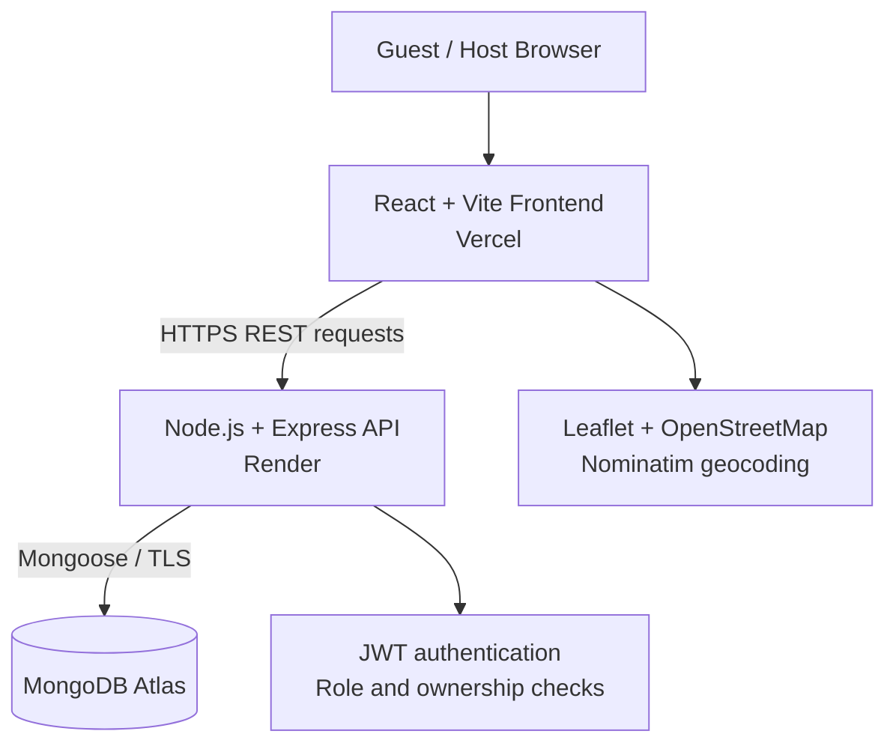
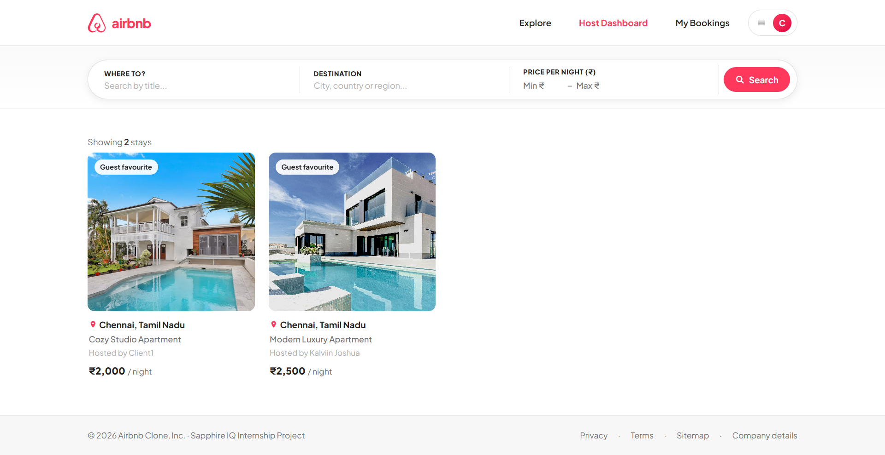
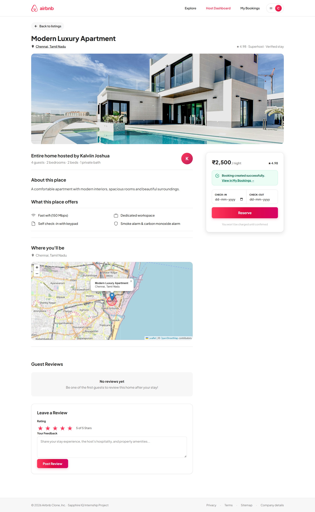
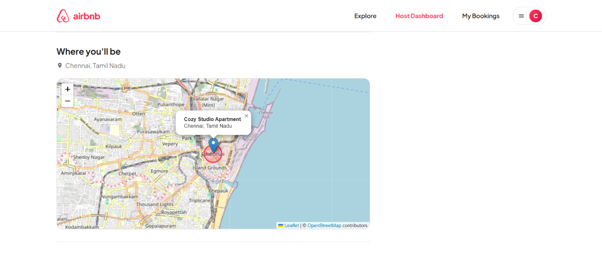
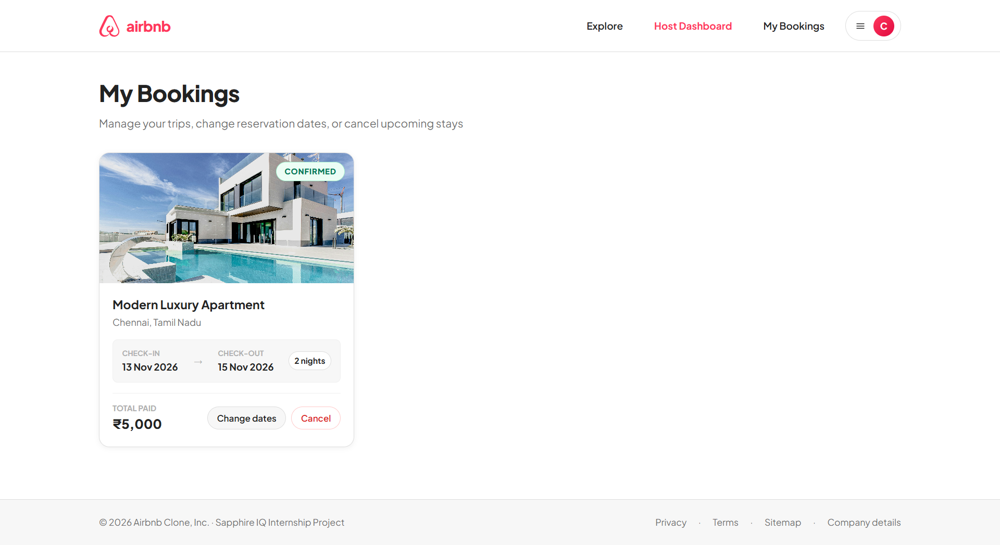
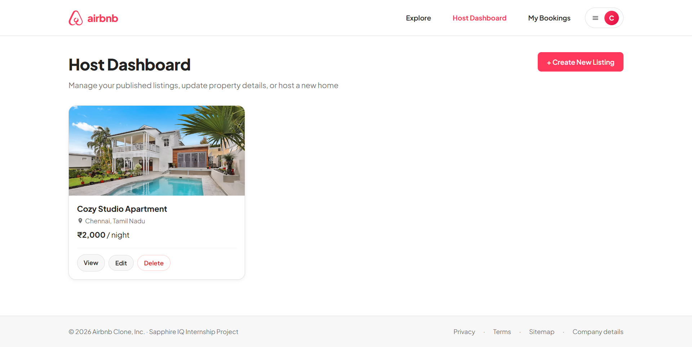
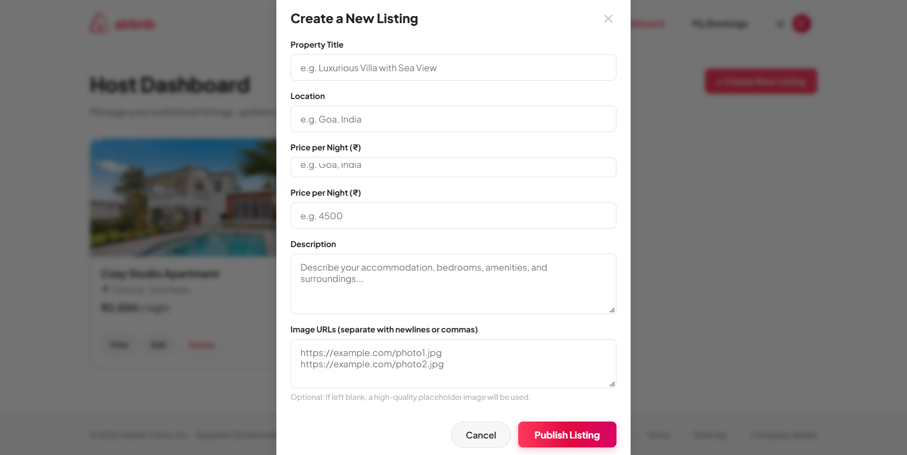

# Airbnb Clone — Full-Stack Property Booking Platform

**Sapphire IQ | Full Stack Developer Internship Project**

[](https://airbnb-clone-hazel-one-99.vercel.app/) [](https://airbnb-clone-api-mglh.onrender.com/api/health) [](https://react.dev/) [](https://nodejs.org/) [](https://www.mongodb.com/)

A responsive, full-stack accommodation discovery and reservation application inspired by Airbnb. Guests can explore properties, view location maps, manage reservations, and read reviews. Authorized hosts can publish and manage their listings. The application is deployed with a React frontend on **Vercel**, an Express API on **Render**, and a **MongoDB Atlas** database.

> **Disclaimer:** An independent educational project built during the Sapphire IQ internship. Not affiliated with, endorsed by, or operated by Airbnb, Inc.

## Live Links

| Resource | URL |
| --- | --- |
| Application | https://airbnb-clone-hazel-one-99.vercel.app/ |
| Backend health check | https://airbnb-clone-api-mglh.onrender.com/api/health |
| Source code | https://github.com/KalviinJoshua/airbnb-clone |

> The backend uses Render's free service tier, which can introduce a delay on the first request after inactivity.

## Features

### Guest experience
- Account registration and login with JWT-based authentication and hashed passwords.
- Browse property listings and view property details, images, location, and nightly pricing.
- Search/filter accommodation listings.
- Book available dates with server-calculated reservation totals.
- View, update, and cancel your own bookings.
- Reject overlapping reservations for the same listing under normal sequential requests.
- View listing reviews and ratings; review submission requires an eligible completed stay.
- Explore property locations using **Leaflet**, **OpenStreetMap**, and **Nominatim** geocoding.
- Responsive UI for desktop and mobile devices.

### Host experience
- Host privileges require an authorization passcode or trusted server-side authorization.
- Role-restricted Host Dashboard.
- Create, view, edit, and delete listings owned by the host.
- Manage published property information and pricing.

### Backend and security
- REST API with Express and Mongoose.
- Protected endpoints using JWT middleware.
- Role-based host authorization and listing ownership controls.
- Booking ownership and review eligibility checks.
- Configurable production CORS allowlist and request-size limit.
- Environment validation, production error handling, and database-aware health endpoint.

## Technology Stack

| Layer | Technologies |
| --- | --- |
| Frontend | React 18, JavaScript, Vite 5, React Router 6, CSS |
| Maps | Leaflet, OpenStreetMap, Nominatim |
| Backend | Node.js, Express 4, REST API |
| Database | MongoDB Atlas, Mongoose 8 |
| Authentication | JWT, bcryptjs |
| Deployment | Vercel (frontend), Render (backend), MongoDB Atlas (database) |
| Development | VS Code, Git, GitHub, npm |

## System Architecture



**Typical booking flow:** The user signs in → opens a listing → selects dates → the frontend submits an authenticated booking request → the API validates availability and calculates pricing → MongoDB stores the reservation → My Bookings displays the result.

## Project Structure

```text
airbnb-clone/
├── client/                    # React/Vite frontend
│   ├── src/
│   │   ├── components/       # Reusable UI components
│   │   ├── context/          # Authentication state
│   │   ├── pages/            # Explore, listing, auth, bookings, host dashboard
│   │   └── App.jsx           # Client routes
│   ├── .env.example
│   ├── vercel.json            # SPA fallback routing
│   └── package.json
├── server/                    # Express/Mongoose API
│   ├── src/
│   │   ├── config/           # Database and environment validation
│   │   ├── controllers/      # Request handlers / business logic
│   │   ├── middleware/       # Authentication and role enforcement
│   │   └── routes/           # Auth, listings, bookings, reviews
│   ├── server.js             # Express entry point
│   ├── .env.example
│   └── package.json
└── README.md
```

## API Reference

**Base URL:** `https://airbnb-clone-api-mglh.onrender.com/api`

Use `Authorization: Bearer <JWT>` for protected endpoints.

| Method | Endpoint | Access | Purpose |
| --- | --- | --- | --- |
| GET | `/health` | Public | API and database health |
| POST | `/auth/register` | Public | Create an account |
| POST | `/auth/login` | Public | Authenticate and receive a token |
| POST | `/auth/upgrade-to-host` | Signed-in user + host authorization | Activate host privileges |
| GET | `/listings` | Public | Browse listings |
| GET | `/listings/:id` | Public | Get listing details |
| POST | `/listings` | Host | Create listing |
| PUT | `/listings/:id` | Owning host | Update listing |
| DELETE | `/listings/:id` | Owning host | Delete listing |
| GET | `/bookings` | Authenticated | View account bookings |
| GET | `/bookings/:id` | Authorized user | View booking details |
| POST | `/bookings` | Authenticated | Create booking |
| PUT | `/bookings/:id` | Authorized user | Update booking |
| DELETE | `/bookings/:id` | Authorized user | Cancel/delete booking |
| GET | `/reviews/listing/:listingId` | Public | Reviews for a listing |
| GET | `/reviews/:id` | Public | Review details |
| POST | `/reviews` | Authenticated + eligible | Submit review |
| PUT | `/reviews/:id` | Authorized user | Update review |
| DELETE | `/reviews/:id` | Authorized user | Delete review |

**Example health check:**

```bash
curl https://airbnb-clone-api-mglh.onrender.com/api/health
```

A healthy response reports `status: "ok"` and `database: "connected"`. The endpoint returns HTTP 503 if MongoDB is disconnected.

**Representative error responses:** `401` for missing/invalid authentication, `403` for forbidden actions, `404` for missing resources, and `409` for overlapping reservations. Exact responses depend on the operation.

## Local Development

### Prerequisites
- Node.js (Node 22 recommended; deployed backend configured with Node 22.16.0)
- npm
- MongoDB Atlas cluster or accessible MongoDB database
- Git

### 1. Clone the repository

```bash
git clone https://github.com/KalviinJoshua/airbnb-clone.git
cd airbnb-clone
```

### 2. Configure and run the backend

```bash
cd server
npm install
```

Copy `server/.env.example` to `server/.env` and configure:

```dotenv
PORT=5000
NODE_ENV=development
CORS_ORIGIN=http://localhost:5173
MONGO_URI=your_mongodb_connection_string
JWT_SECRET=your_long_random_secret_at_least_32_characters
JWT_EXPIRES_IN=7d
HOST_REGISTRATION_SECRET=your_strong_private_host_passcode
TRUSTED_HOST_EMAILS=
```

Start the API:

```bash
npm run dev
```

The API runs at `http://localhost:5000`; check `http://localhost:5000/api/health`.

### 3. Configure and run the frontend

In a **second terminal** from the repository root:

```bash
cd client
npm install
```

Copy `client/.env.example` to `client/.env`:

```dotenv
VITE_API_URL=http://localhost:5000/api
```

Start the frontend:

```bash
npm run dev
```

Open the URL displayed by Vite (typically `http://localhost:5173`).

### 4. Production build check

```bash
cd client
npm run build
```

> Never commit `.env` files, MongoDB credentials, JWT secrets, or host passcodes. Variables prefixed with `VITE_` are exposed to browser builds and must not contain secrets.

## Deployment

### Frontend — Vercel
1. Import the GitHub repository into Vercel.
2. Set **Root Directory** to `client`.
3. Framework: **Vite**; build command: `npm run build`; output directory: `dist`.
4. Set the environment variable:

   ```dotenv
   VITE_API_URL=https://airbnb-clone-api-mglh.onrender.com/api
   ```

5. Deploy. `client/vercel.json` rewrites client-side routes to `index.html` to support direct navigation and refreshes.

### Backend — Render
1. Create a Node.js web service connected to the GitHub repository.
2. Set **Root Directory** to `server`.
3. Build command: `npm install`; start command: `npm start`.
4. Configure Render environment variables (secrets only in the Render dashboard):

   ```dotenv
   NODE_ENV=production
   NODE_VERSION=22.16.0
   CORS_ORIGIN=https://airbnb-clone-hazel-one-99.vercel.app
   MONGO_URI=your_mongodb_atlas_uri
   JWT_SECRET=your_long_random_secret
   JWT_EXPIRES_IN=7d
   HOST_REGISTRATION_SECRET=your_strong_private_host_passcode
   ```

5. Set the health-check path to `/api/health`.
6. In MongoDB Atlas Network Access, allow the Render service's current outbound IP ranges, and maintain those entries if infrastructure changes. Avoid broad public access when practical.
7. Verify the health endpoint and test frontend-to-API communication.

### Database — MongoDB Atlas
- Create a cluster and database user with appropriate permissions.
- Use the Atlas application connection string as `MONGO_URI`.
- Configure network access for the deployed backend.
- Keep credentials outside source control and rotate them if exposed.

## Screenshots

### 1. Explore Page


### 2. Property Details


### 3. Interactive Property Map


### 4. My Bookings


### 5. Host Dashboard


### 6. Create New Listing


## Manual Test Results

The following checks were reported successful on the deployed application:

| Test | Result |
| --- | --- |
| Login and session persistence | Passed |
| Booking creation and display in My Bookings | Passed |
| Overlapping-date rejection (sequential requests) | Passed |
| Booking date update | Passed |
| Booking cancellation | Passed |
| Map and property marker rendering | Passed |
| Rejection of reviews without eligible completed stay | Passed |
| Host authorization and dashboard access | Passed |
| Host listing creation, editing, deletion | Passed |
| Guest/unauthenticated route restrictions | Passed |
| Unauthenticated bookings API request returns 401 | Passed |
| API health, listing retrieval, refresh and console checks | Passed |

These are **manual functional checks**, not a comprehensive penetration test or full automated test suite.

## Known Limitations and Future Improvements

1. **Concurrent booking requests:** Sequential overlap checks passed, but simultaneous requests may require a concurrency-safe/atomic reservation mechanism to prevent race conditions.
2. **Review lifecycle:** Rejection of an ineligible review was verified; successful review creation following a genuinely completed stay still needs an end-to-end test.
3. **Authorization depth:** UI restrictions and unauthenticated API protection were checked. Cross-account ownership and IDOR tests should be automated for bookings, listings, and reviews.
4. **Free-tier cold starts:** The Render service can take additional time to respond after inactivity.
5. **Dependency maintenance:** Re-run `npm audit` for both applications and update vulnerable dependencies after compatibility testing.
6. **Test automation:** Add API integration tests, frontend component tests, and an end-to-end suite (for example, Playwright).
7. **Production maturity:** Consider rate limiting, stronger request validation, observability, accessible UI testing, image hosting, and a scalable booking transaction strategy.

## Security Notes

- Passwords are hashed with bcryptjs; API access is authenticated using JWTs.
- Backend secrets belong in environment variables, never in frontend bundles or source control.
- Host elevation requires a trusted server-side authorization mechanism.
- Production CORS is configured for explicit frontend origins.
- Authorization must be enforced by the API even when the frontend hides restricted controls.
- This internship project should not be interpreted as independently security-certified.

## Developer

**D Kalviin Joshua**  
Full Stack Developer Intern — **Sapphire IQ**  
B.Tech, Computer Science and Engineering  
SRM Institute of Science and Technology

GitHub: [@KalviinJoshua](https://github.com/KalviinJoshua)

## Acknowledgment

Developed as a full-stack engineering project during the **Sapphire IQ internship**, with a focus on practical frontend development, backend APIs, database integration, authorization, deployment, and testing.

---

**Project status:** Deployed and manually tested; further production hardening is documented above.
